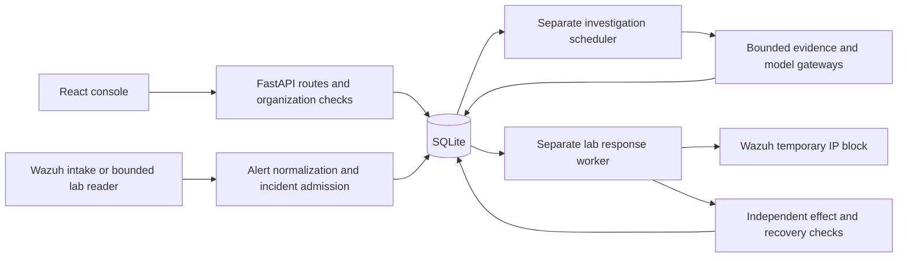

# TERMINUS implementation map

This map connects the October 23 Software Design Document (SDD), the November 9 SRS v2.0, and the delivered repository. It records implementation and verification separately. For evaluation setup, see the [installation manual](INSTALLATION.md).

## Runtime layout

The API serves the React build from `src/terminus/server/static/console/`. Its default startup creates the local database and demo workspace. The scheduler and live response worker have separate entry points. They share SQLite and must be started separately for their respective workflows.

## SDD modules in source

| SDD module | Source entry points | Delivered responsibility |
| --- | --- | --- |
| Console and API | [React routes](../web/src/shell.tsx), [incident workbench](../web/src/views/workbench.tsx), [FastAPI factory](../src/terminus/server/app.py), [console routes](../src/terminus/server/console_api.py) | Routes, organization selection, incident queue and detail, and recorded activity. |
| Identity and organization | [Auth service](../src/terminus/auth/service.py), [organization service](../src/terminus/orgs/service.py), [API dependencies](../src/terminus/server/deps.py) | Authenticates sessions and resolves current role and organization before record access. |
| Alert and incident pipeline | [HTTP intake](../src/terminus/server/routers.py), [normalizer](../src/terminus/ingestion/normalizer.py), [pipeline runner](../src/terminus/pipeline/runner.py), [live SSH admission](../src/terminus/response/live.py) | Converts alerts, claims alert identity within the organization, applies policy, and stores incident records. Bounded SSH collection follows the lab admission rules. |
| Coordination and scheduler | [Scheduler entry point](../src/terminus/orchestration/scheduler_cli.py), [queue storage](../src/terminus/orchestration/scheduler_store.py), [specialist runtime](../src/terminus/orchestration/specialists/runtime.py) | Stores investigation jobs and uses leases and role limits to coordinate worker execution. |
| Evidence and tool gateway | [Tool gateway](../src/terminus/toolkit/gateway.py), [Wazuh readers](../src/terminus/toolkit/wazuh_readers.py), [orchestration storage](../src/terminus/orchestration/storage.py) | Applies tool scope and collection bounds and records evidence for citation checks. |
| Model access and policy | [Model policy](../src/terminus/model_gateway/policy.py), [live model client](../src/terminus/model_gateway/live.py), [response contracts](../src/terminus/model_gateway/contracts.py) | Applies connection and routing policy, bounds model context, and validates structured outputs. |
| Workflow and response | [Response console](../web/src/views/incident-response.tsx), [decision routes](../src/terminus/server/response_api.py), [response service](../src/terminus/response/live.py), [worker](../scripts/run_response_worker.py), [transport](../src/terminus/response/wazuh_transport.py), [observer](../src/terminus/response/lab_observer.py) | Stores the exact reviewed proposal and authorization, reserves an intent before sending, then records acknowledgement, independent effect, and recovery. Workflow simulations retain their separate execution records. |
| Storage and reporting | [SQLite schema](../src/terminus/storage/db.py), [response storage](../src/terminus/response/storage.py), [report service](../src/terminus/reports/service.py) | Holds tenant-scoped durable records and generates reports from incident data. Daily report history is held in process memory. |

## SRS v2.0 traceability

Each range includes every numbered identifier between its endpoints. The table maps responsibility, with acceptance status qualified in the final column.

| SRS v2.0 identifiers | Responsible module | Verification or gap |
| --- | --- | --- |
| Req-Func-Sw-1 through Req-Func-Sw-3, Req-Func-Sw-18, Req-Qual-Sec-1 | Identity and organization | Tenant and role checks have automated coverage. |
| Req-Func-Sw-4 through Req-Func-Sw-5, Req-Func-Hw-2 through Req-Func-Hw-3, Req-Qual-Sec-2 | Alert pipeline, API and storage | Trusted lab import and persistence have evidence. Complete authenticated HTTP intake acceptance is tracked in SCRUM-20. |
| Req-Func-Sw-6 through Req-Func-Sw-8, Req-Qual-Perf-1 | Alert pipeline and policy | The SSH lab has deterministic threshold evidence. General per-alert rule identifier logging and the 1,000-alert benchmark remain open. |
| Req-Func-Sw-9, Req-Func-Sw-13, Req-Func-Hw-1, Req-Func-Hw-6, Req-Qual-Rel-1 | Scheduler and storage | Durable jobs and bounded retry paths exist. The acknowledged-alert outage test remains open. The reference host inventory meets the memory and processor thresholds. |
| Req-Func-Sw-10 through Req-Func-Sw-12, Req-Func-Hw-4 | Evidence and model gateways | Redaction, verdict contracts and citation checks have automated coverage. A saved file-integrity investigation used Gemini after an explicit retry. |
| Req-Func-Sw-14 through Req-Func-Sw-15, Req-Func-Hw-5, Req-Qual-Use-1 through Req-Qual-Use-2 | Console and API | The queue and detail use HTTP queries and polling. The backend has [an SSE endpoint](../src/terminus/server/streaming.py). Browser incident-status SSE acceptance remains open in SCRUM-16. |
| Req-Func-Sw-16 through Req-Func-Sw-17, Req-Func-Sw-19, Req-Qual-Sec-3, Req-Qual-Rel-2 | Workflow and response | The live decision service has scoped approval and recovery evidence. The lab ran a 60-second block with a 30–120 second revision range. The SRS requires a 15-minute lease. SCRUM-15 tracks conformance and SCRUM-14 tracks browser-driven acceptance. |
| Req-Func-Sw-20 through Req-Func-Sw-21 | Console, API and response audit | Organization-scoped response decisions and audit events are persisted. General triage rule decisions and end-to-end console evidence remain open. |
| Req-Qual-Maint-1 | Project tooling | Ruff and Basedpyright are configured. The release static-analysis gate is tracked in SCRUM-18. |

The earlier design and build notes describe proposed architecture. The current service uses Python's SQLite driver and a local SQLite database. PostgreSQL, Redis, automatic file restoration, and production deployment are outside the verified delivery scope. The [lab testing record](TESTING_STATUS.md) distinguishes fixture checks from live evidence.

## Source headers

Maintained Python, TypeScript, JavaScript, CSS, HTML, launch scripts and commented configuration files carry file, team author, revision date, package version and purpose. The revision date identifies this delivery pass. Git history retains individual authorship. Bundled console output is generated by Vite. JSON and lockfiles keep their native formats.
