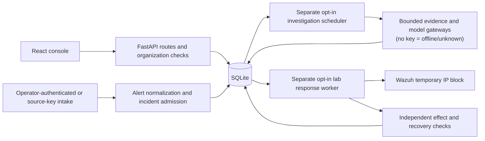

# TERMINUS implementation map

Team LARP | COSC 3370 | Package version 0.1.0 | November 13, 2026

This map connects the October 23 Software Design Document (SDD), the November 9 SRS v2.0, and the delivered repository. It records implementation and verification separately. For evaluation setup, see the [installation manual](INSTALLATION.md).

## Runtime layout

The API serves the React build from `src/terminus/server/static/console/`. Its default startup creates the local SQLite database without presentation agents, workflows, or incidents; those fixtures require `TERMINUS_DEMO_SEED_ENABLED` in local mode. The scheduler and live response worker have separate entry points. They share SQLite and must be started separately for their respective workflows. The normal launcher starts the API only; a healthy API does not show worker readiness. Operator intake routes require an authenticated session and are marked as operator submissions. A separate `/sources/wazuh` route requires a configured source key and organization, records a raw receipt hash, and binds the tenant. Private lab Integrator delivery from genuine target-agent SSH telemetry and one exact-digest approved 60-second block with independent expiry/recovery passed; fresh-install and broader response acceptance remain open.

## SDD modules in source

| SDD module | Source entry points | Delivered responsibility |
| --- | --- | --- |
| Console and API | [React routes](../web/src/shell.tsx), [incident workbench](../web/src/views/workbench.tsx), [FastAPI factory](../src/terminus/server/app.py), [console routes](../src/terminus/server/console_api.py) | Routes, organization selection, incident queue and detail, and recorded activity. |
| Identity and organization | [Auth service](../src/terminus/auth/service.py), [organization service](../src/terminus/orgs/service.py), [API dependencies](../src/terminus/server/deps.py) | Authenticates sessions and resolves current role and organization before record access. |
| Alert and incident pipeline | [HTTP intake](../src/terminus/server/routers.py), [Wazuh Integrator script](../scripts/lab/custom-terminus), [normalizer](../src/terminus/ingestion/normalizer.py), [pipeline runner](../src/terminus/pipeline/runner.py), [live SSH admission](../src/terminus/response/live.py) | Converts alerts, claims alert identity within the organization, applies policy, and stores incident records. Operator intake records its origin; a separate source-key route binds a configured Wazuh source to one organization and preserves a receipt hash. Bounded SSH collection follows the lab admission rules. |
| Coordination and scheduler | [Scheduler entry point](../src/terminus/orchestration/scheduler_cli.py), [queue storage](../src/terminus/orchestration/scheduler_store.py), [specialist runtime](../src/terminus/orchestration/specialists/runtime.py) | Stores investigation jobs and uses leases and role limits to coordinate worker execution. The scheduler is a separate process with explicitly installed handlers; the API launcher does not start it. |
| Evidence and tool gateway | [Tool gateway](../src/terminus/toolkit/gateway.py), [Wazuh readers](../src/terminus/toolkit/wazuh_readers.py), [orchestration storage](../src/terminus/orchestration/storage.py) | Applies tool scope and collection bounds and records evidence for citation checks. |
| Model access and policy | [Model policy](../src/terminus/model_gateway/policy.py), [live model client](../src/terminus/model_gateway/live.py), [response contracts](../src/terminus/model_gateway/contracts.py) | Applies connection and routing policy, bounds model context, and validates structured outputs. With no configured key, the legacy path runs offline and must report its result as unknown. |
| Workflow and response | [Response console](../web/src/views/incident-response.tsx), [decision routes](../src/terminus/server/response_api.py), [response service](../src/terminus/response/live.py), [worker](../scripts/run_response_worker.py), [transport](../src/terminus/response/wazuh_transport.py), [endpoint command](../scripts/lab/terminus_ip_block.py), [observer](../src/terminus/response/lab_observer.py) | Stores the exact reviewed proposal and authorization, reserves an intent before sending, then records acknowledgement, independent effect, and recovery. The worker is opt-in and limited to the fixed lab scope; the normal launcher does not start it. The worker verifies Wazuh TLS by default, with an explicit exception limited to fixed disposable Docker lab endpoints. The lab target removes empty owned nftables tables on a bounded timer; the separate observer must confirm absence. Workflow simulations retain their separate execution records. |
| Storage and reporting | [SQLite schema](../src/terminus/storage/db.py), [campaign stitcher](../src/terminus/correlation/stitcher.py), [response storage](../src/terminus/response/storage.py), [report service](../src/terminus/reports/service.py), [report history](../src/terminus/reports/storage.py) | Holds tenant-scoped durable records, campaign assignments, and generated report snapshots in the local SQLite file. Campaign storage retains only alert fields needed for its recent summary, not a second raw log. Campaign restart, duplicate, tenant isolation and minimization have fixture tests; a real multiworker and backup/restore acceptance remains open. |

The class SDD response sequence and test description should show the disposable target's periodic empty-table cleanup as a separate step after TTL recovery, followed by the independent observer's `table-absent` check. This has fixture coverage only and does not change SRS v2.0 status until the fresh lab check passes. The presentation entry-point description should point to the isolated rehearsal; its synthetic stream is constrained to loopback, does not follow redirects, and does not clear operational records.

## SRS v2.0 traceability

Each range includes every numbered identifier between its endpoints. The table maps responsibility, with acceptance status qualified in the final column.

| SRS v2.0 identifiers | Responsible module | Verification or gap |
| --- | --- | --- |
| Req-Func-Sw-1 through Req-Func-Sw-3, Req-Func-Sw-18, Req-Qual-Sec-1 | Identity and organization | Tenant and role checks have automated coverage. |
| Req-Func-Sw-4 through Req-Func-Sw-5, Req-Func-Hw-2 through Req-Func-Hw-3, Req-Qual-Sec-2 | Alert pipeline, API and storage | Trusted lab import and persistence have evidence. Operator intake requires an authenticated member/operator session. A source-key `/sources/wazuh` route binds one configured source to an organization and records a receipt hash. A private lab delivery from genuine target-agent SSH telemetry passed; fresh-install replay and broader source acceptance remain open in SCRUM-20. |
| Req-Func-Sw-6 through Req-Func-Sw-8, Req-Qual-Perf-1 | Alert pipeline and policy | The SSH lab has deterministic threshold evidence. General per-alert rule identifier logging and the 1,000-alert benchmark remain open. |
| Req-Func-Sw-9, Req-Func-Sw-13, Req-Func-Hw-1, Req-Func-Hw-6, Req-Qual-Rel-1 | Scheduler and storage | Durable jobs and bounded retry paths exist. The acknowledged-alert outage test remains open. The reference host inventory meets the memory and processor thresholds. |
| Req-Func-Sw-10 through Req-Func-Sw-12, Req-Func-Hw-4 | Evidence and model gateways | Redaction, verdict contracts and citation checks have automated coverage. A saved file-integrity investigation used Gemini after an explicit retry. Without a configured key or connection, analysis runs offline and must be reported as unknown, not as provider evidence. |
| Req-Func-Sw-14 through Req-Func-Sw-15, Req-Func-Hw-5, Req-Qual-Use-1 through Req-Qual-Use-2 | Console and API | The queue and detail use HTTP queries and polling. The backend has [an SSE endpoint](../src/terminus/server/streaming.py). Browser incident-status SSE acceptance remains open in SCRUM-16. |
| Req-Func-Sw-16 through Req-Func-Sw-17, Req-Func-Sw-19, Req-Qual-Sec-3, Req-Qual-Rel-2 | Workflow and response | The disposable Docker lab recorded one exact-digest human approval, Wazuh endpoint effect, independent blocked-source/healthy-management checks, kernel expiry, and independent recovery. Two earlier API acknowledgements with no effect remain `recovered_unverified`. The normal launcher does not start or supervise the response worker. Empty owned firewall-table cleanup has fixture tests but no live observer acceptance. The lab ran a 60-second block with a 30–120 second revision range; the SRS requires a 15-minute lease. SCRUM-15 tracks conformance and SCRUM-14 tracks browser-driven acceptance. |
| Req-Func-Sw-20 through Req-Func-Sw-21 | Console, API and response audit | Organization-scoped response decisions and audit events are persisted. General triage rule decisions and end-to-end console evidence remain open. |
| Req-Qual-Maint-1 | Project tooling | Ruff and Basedpyright are configured. The release static-analysis gate is tracked in SCRUM-18. |

The [analyst comparison protocol](ANALYST_VALIDATION.md) adds a five-case Wazuh-only baseline and scoring description for the class test copy. It is a planned acceptance method, not a completed usability result or a new SRS requirement.

The earlier design and build notes describe proposed architecture. The current service uses Python's SQLite driver and a local SQLite database. PostgreSQL, Redis, automatic file restoration, and production deployment are outside the verified delivery scope. The setup helper now writes only the SQLite-compatible runtime settings and supported TERMINUS_ environment values; it does not offer a database backend selection or generate a license token. The [lab testing record](TESTING_STATUS.md) distinguishes fixture checks from live evidence.

For the class SDD and test-description copies, update campaign correlation storage to the `campaigns` and `campaign_alerts` SQLite tables, including the per-organization alert key, transactional assignment, 15-minute default window, minimal summary fields, and restart/duplicate/tenant-isolation/data-minimization test cases in [the campaign persistence tests](../tests/test_campaign_persistence.py). This documentation update does not promote the simulation to a live Wazuh acceptance result.

## Source headers

Maintained Python, TypeScript, JavaScript, CSS, HTML, launch scripts and commented configuration files carry file, team author, revision date, package version and purpose. The revision date identifies this delivery pass. Git history retains individual authorship. Bundled console output is generated by Vite. JSON and lockfiles keep their native formats.
